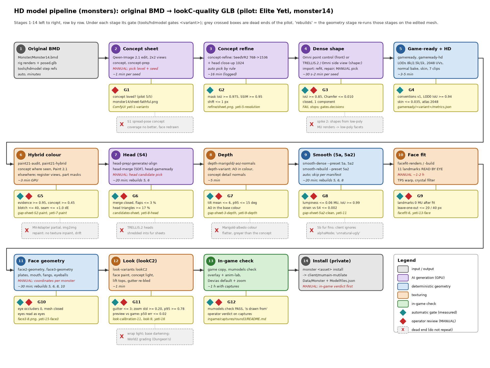
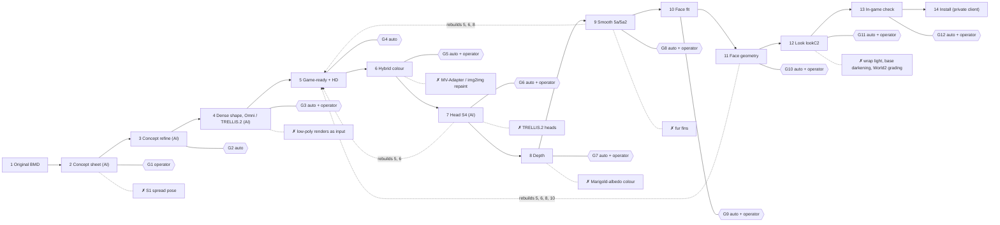

# HD model pipeline: from the original BMD to a lookC-quality GLB

`tools/hdmodel` (OpenSpec change `add-hd-model-pipeline`, capability `hd-model-pipeline`)
turns an original MU model plus the operator's picks into a game-ready HD GLB, and on
request installs it into the private client's game data. **Monsters are the only
supported model kind** (`tools/hdmodel monster <asset> …`, manifests under
`tools/hdmodellib/manifests/monster/`); players, NPCs and items are later changes.

History: the pipeline was built in spike 3 (`spike-hd-guided-geometry`) on the
spike branch `hd-geometry-spike` as `tools/hdspike` and imported into mainline by
`add-hd-model-pipeline`. The pilot's numbers, review sheets and ComfyUI workflows
below are that spike's recorded outputs: they live in the spike's output root
(`.review/hd-concept/` of slot 5, the "spike root" below; preserved copies in
mainline's `data/media/hd-guided-spike/`). New runs write `.review/hd-models/`.

**This is the reference** (what each stage does, every gate with its evidence, the
dead ends, the preview calibration). **The procedure** (host setup with every
weight and its sha256, `tools/hdmodel doctor`, re-running the three monsters,
adding a monster, troubleshooting) is
[`docs/hd-model-reproduce.md`](hd-model-reproduce.md); agents follow the skill
`.agents/skills/hd-model-pipeline/SKILL.md`.

Pilot: the Elite Yeti (`Monster/Monster14.bmd`, asset id `monster14`). The
operator accepted `omni-faithful-headhd-smooth2-face3-lookC2-hd` as "a good
candidate" (lookC plus a UV-gutter fix). Two more monsters went through the
driver and were accepted in game: the Budge Dragon (`monster03`,
`omni-faithful-smooth2-lookC2-hd`, root `monsters/run`) and the Bloody Wolf
(`monster44`, `t2left-reimagined-lookW3-eyes2-hd`, root `monsters/wolf-t2`). The
Wolf added the shape options (TRELLIS.2 on the side view, mesh repair), the
colour options (registered views, part masks), skipped smoothing, gate
decisions and moved effect joints; they are described where they act below.

Contents: [Overview](#overview) · [Prerequisites](#prerequisites) ·
[Stages](#stages) · [Gates in one command](#gates-in-one-command) ·
[Dead ends](#dead-ends-and-why) · [Preview vs game](#preview-vs-game) ·
[Generalising](#generalising-to-other-monsters) · [Glossary](#glossary) ·
[Where things are](#where-things-are) · [Checklist](#one-page-checklist)

## Overview

An AI image model redraws four views of the original monster as a detailed
concept sheet. The operator picks one sheet. A shape generator then builds a
dense 3D mesh that follows both the concept and the original's outline.
Deterministic scripts turn that mesh into a game-ready GLB with the original
skeleton, all seven animations, three LODs and 2048² textures. The colour
comes from the concept wherever a concept view sees the surface; Hunyuan3D-Paint
fills the rest. Later passes fix the head, the lumpy body surface, the face and
the in-game contrast. After every stage a **gate** decides whether to continue.
Some gates are measured, read from files the stage wrote
(`tools/hdmodel gates <variant>`). Others are an operator verdict on a named
review sheet or ComfyUI workflow. An accepted model is installed into the
private client with `tools/hdmodel monster <asset> install` (stage 14).



The PNG is drawn by `docs/hd-model-pipeline-diagram.py` (matplotlib). The
same graph as Mermaid (`docs/hd-model-pipeline.mmd`):



The full Mermaid source, with colours by kind and the review file names, is
`docs/hd-model-pipeline.mmd`.

How to read the stage numbers: stages 1–6 build a complete first variant
(the "S2 hybrid", `omni-faithful-hybrid-hd`). Stages 7, 9 and 11 change the
**geometry**, so each one re-runs the game-ready, colour and depth stages on
the edited mesh (`head-gameready`, `smooth-rebuild`). Stages 10 and 12 change
**texture only**.

## Prerequisites

Host, installs, weights, ComfyUI and its network namespace, the GPU lock and
the environment variables: [`docs/hd-model-reproduce.md`](hd-model-reproduce.md)
sections 1–2. The machine-readable list of every prerequisite (binaries,
installs, ComfyUI node classes, every weight with URL at a pinned revision, size
and sha256) is `tools/hdmodellib/prereqs.yaml`; `tools/hdmodel doctor [--full]
[--json]` checks it on a host. In short:

- Blender 5.2.1, system Python ≥ 3.12 with numpy, Pillow, PyYAML and openvdb,
  ffmpeg; one NVIDIA GPU with ≥ 24 GB (pilot: RTX 5090, 32 GB);
- ComfyUI 0.38.0 (core nodes only) with Qwen-Image 2.1, FLUX.2 Klein, SeedVR2,
  4x-UltraSharpV2, Marigold v2 and TRELLIS.2; Hunyuan3D-Omni and
  Hunyuan3D-Paint 2.1 in their own venvs (runners in `tools/hdmodellib/host/`);
- **one GPU job at a time** through one host-wide lock file,
  `$XDG_RUNTIME_DIR/mutilate/gpu.lock` (`HDMODEL_GPU_LOCK` overrides): the
  tool's ComfyUI commands and `spin-video` take it, and the tool passes it to
  both `gpu-run.sh` wrappers as `OMNI_GPU_LOCK` / `HY3DPAINT_GPU_LOCK`;
- ComfyUI runs in the `vpn3` network namespace on the pilot host;
  `tools/hdmodel` re-runs its ComfyUI commands there itself
  (`tools/hdmodellib/incomfy.sh`, passwordless `sudo -n nsenter`).

All paths below are relative to the workspace root unless they start with `gen/`,
`gameready/`, `review/` and the like. Those are relative to the output root,
`.review/hd-models/` for new runs (`HDMODEL_OUT`); the pilot's recorded files
are relative to the spike root.

### Time and VRAM per stage (pilot measurements)

| Stage | Wall time | Peak VRAM | Evidence |
|---|---|---|---|
| 2 concept, per sheet and seed | ~1 min | ComfyUI (Qwen-Image 2.1) | `concept.log`; now `<asset>/concept.json` `runs.*.seconds` |
| 3 refine | ~16 min: ~3.3 min per view (5 candidates), ~1 min head close-up | ComfyUI (SeedVR2 7B, Qwen) | candidate file times of the 2026-10-13 run; now logged in `refine.json` `seconds` |
| 4 Omni, per seed | 30 s (+10 s load) | 8.6 GB | `align.json` `omni_run` |
| 5 game-ready + HD | ~3–5 min (decimation 50 s, UV, bake, skin ~5 s; projection ~1 min) | CPU | `metrics.json` `timings` |
| 6 Paint 2.1 custom15-512 + hybrid | 99 s + ~2 min | 22.5 GB (768 px views run out of memory) | `paint21/*/audit.json` |
| 7 head: Omni head, per seed; merge; rebuild | 40 s; 17 s; ~10 min | 8.6 GB | `head/`, `merge.json` |
| 8 depth: Marigold, per view; AO; normals | ~30 s; 9 s; ~1 min | ComfyUI | `depth/` |
| 9 smooth: per geometry pass; rebuild | ~2.5 min; ~12 min | CPU (OpenVDB); Paint in the rebuild | `smooth.json` `timings`, run logs |
| 10 face fit (build) | ~4 min plus 1–2 h by hand | CPU | `face2/facefit-face3.log` |
| 11 face geometry (face3); rebuild | 7.5 s; ~12 min | CPU | `face3-geometry.json` |
| 12 look variant | ~30 s | CPU | `metrics.json` `surface.lod0.seconds` |
| 13 in-game round (slot 2) | ~1 h including captures | client | `ingame/captures/*/README.md` |

## The driver: `tools/hdmodel monster` (primary entry point)

Every monster has a manifest, `tools/hdmodellib/manifests/monster/<asset>.yaml`, and one
command runs the stages below from it:

```sh
export HDMODEL_DATA=$PWD/client/mumain-mutilate/src/bin/Data
tools/hdmodel monster <asset> status [--root DIR]
tools/hdmodel monster <asset> run [--from STAGE] [--to STAGE] [--root DIR] [--force]
                                  [--reuse-from DIR [--reuse KIND ...]]
tools/hdmodel monster <asset> install [--glb FILE] [--root DIR]
```

- **`--root`** is the output root the run writes (default `HDMODEL_OUT`,
  else `.review/hd-models`). It holds everything, including the rig renders
  (`refs/<asset>/`) and the original GLB (`compare/glb/<asset>/orig.glb`).
- **Stages,** in order: `refs` (1), `concept` (2), `refine` (3), `shape` (4),
  `gameready` (5), `colour` (6), `head` (7), `depth` (8), `smooth` (9),
  `face` (10–11), `look` (12), `ingame` (13). Each stage runs `tools/hdmodel`
  commands as child processes (`tools/hdmodel step <command>`, or a top-level
  command such as `concept-prep`), with `HDMODEL_MONSTER=<asset>` and
  `HDMODEL_OUT=<root>`, so every module reads this monster's manifest and
  writes under this root. A step whose outputs exist is skipped, unless an
  earlier step of the same run ran: from then on, every later step runs again,
  because its inputs may have changed. `--force` runs every step, but each
  command still keeps its own caches.
- **Gates.** After a stage, `run` evaluates that stage's gates
  (`tools/hdmodel gates <variant> --stages …`). On a FAIL it stops (exit 1),
  names the gate, gives a hint and points to the gate report. **A FAIL is a
  stop**: the only way past it is the operator's decision in the manifest,
  `gates.decisions: {"<stage>/<gate id>": "<who, when, why>"}`. That FAIL
  stays a FAIL with its value; the report prints `OPERATOR DECISION: …` next to
  it, counts it as `FAIL+decision`, and `run` continues. The Wolf records seven
  (the BMD-silhouette gates after the operator's reimagined shape pick, five
  colour gates after the part masks: "2 then in-game"). The Dragon's two shape
  FAILs pass by the operator's in-game acceptance ("wings are fine",
  2026-10-16), recorded in its `gates.decisions`.
- **MANUAL stops.** When a step needs a choice that the manifest does not
  hold yet, `run` stops. It says what to review and which field to fill, then
  continues from there when run again:

  | Stage | Stop | Review | Field |
  |---|---|---|---|
  | concept | pick the sheet | `<root>/<asset>/sheet-*.png` (per level), G1 | `picks.concept` (`qwen-faithful-s22`) |
  | shape | pick the shape seed (Omni, or the `shape:` generator) | each seed's `gen/<concept>/shapes/<source>-s<seed>/<asset>/align.json` and the clay shape, G3 | `picks.omni_seed` (2) |
  | head | pick the head | `<root>/head/candidates-sheet.png`, G6 | `picks.head_candidate` (`omni-s2`) |
  | face | read the landmarks by eye | `<root>/facefit/renders/` beside `head-front-lit.png` | `face.landmarks` (+ `mouth_group`, `region`) |
  | ingame | the in-game round | the `ingame/<candidate>-2048.glb` game copy, the captures | `stages.ingame.verdict` |

  `run` exits 2 at a MANUAL stop. Face-geometry passes are optional: with
  `face.passes: []` the face stage only fits. The operator's verdict gates (MANUAL in `gates`) are listed in
  each stage's gate report; they do not stop the run.
- **Skipped stages.** `head.enabled: false` (no head bone, a helmet, too
  small to matter) skips stage 7; the lineage then runs on the B base
  (`omni-<level>`, no `-headhd`). `face.enabled: false` (no readable face:
  insects, helmets) skips stages 10–11 and the face paint, and the look
  starts from smooth2's depth variant. `stages.<stage>.skip: true` skips any
  other stage: the Wolf skips smoothing (`stages.smooth.skip`, "the Yeti
  presets melt the straps, muzzle and mane spikes"), and its look then starts
  from the depth variant.
- **State.** `<root>/<asset>/driver-state.json` holds, per stage, every step
  (ran / reused / present, seconds, log) and the gate results.
  `<root>/<asset>/driver-logs/` holds the logs and the per-stage gate
  reports. `status` prints the stage table (done / open / blocked / failed /
  skipped / todo, with the recorded PASS/FAIL/FAIL+decision/MISSING/MANUAL
  counts), the picks, the manifest's lighting beside the lighting in the
  candidate GLB, the in-game verdict and the install record.
- **Reuse** (`--reuse-from DIR`, for regressions). The GPU outputs of
  `--reuse` kinds are **copied** from another concept root instead of being
  generated. The kinds are `concept` (the picked sheet), `refine` (refined
  refs), `omni` (shape GLBs, also TRELLIS.2's `shapegen/`), `head` (head
  candidates), `marigold` and `paint`. Paint 2.1 runs are copied only when the Paint input LOD0
  (`paint21/<base>/lod0.glb`) is byte-identical, so the bake fits the UVs
  (`paint21.REUSE_ENV`). Nothing is written into `DIR`.
- **The preview calibration** (`look/calibrate11/calibration.json`) is the
  client's lighting, the same for every monster. The `look` stage copies it
  from `tools/hdmodellib/pilot/calibration.json` for the preview gates.
- **GPU.** The driver adds no lock of its own. Omni and Paint take the shared
  lock through their `gpu-run.sh` (the tool passes its lock path); the ComfyUI
  commands take it through `shapes.gpu_lock`.
- **Install** (stage 14, `install [--glb FILE]`): copies the candidate's game
  copy (or `--glb`) byte for byte to the private client's
  `src/bin/Data/<bmd with .glb>` and adds or replaces the model's entry in
  `Data/Models/ModelFiles.json`. It refuses, before writing, any client tree
  other than `client/mumain-mutilate` (the public fork `client/mumain-sven`
  included), a GLB that `tools/mumodels check` refuses, one that identifies
  another model, maps above the client's 2048 limit and a monster without an
  in-game verdict. It records source, sha256 and date in `stages.install` and
  commits nothing. Models are never wired into the game outside the private
  clone.

### The monster manifest

The schema and the generic face operations are documented in
`tools/hdmodellib/manifests/README.md`. `monsterspec.py` checks the manifest and
fills in defaults. `monster14.yaml` reproduces the pilot exactly: every module
constant it replaced was compared with the old hard-coded value, and the
`gates` table for the pilot's lookC2 is unchanged except for the new
`model-lighting` row. Fields:

- identity: `kind` (required; `monster` is the only supported kind), `asset`, `label`, `bmd`,
  `texture_dirs`, `pose`, `budget`;
  `client.{model, index, scale, play_speed, hold_last_actions}`;
- bone roles: `bones.{head, neck, jaw, hands, feet, sockets, limb_roots,
  rigid, spikes {bones, min_z}, smooth_exclude, seam}`;
- the concept: `concept.{subject, detail, refine_prompt}`; the picks
  `picks.{concept, omni_seed, head_candidate}`; `names.prefix`;
- the shape source (stage 4): `shape.{generator, view, trim_ground, repair}`;
- the colour (stage 6): `colour.{register_views, part_masks, depth_filter}`;
- operator decisions on FAILs: `gates.decisions`;
- budgets and presets: `budgets.{lod_triangles, lod_max_genus, head_share,
  head_share_min, density}`, `head.enabled`, `depth.tile_mu_per_px`,
  `smoothing.{passes, keep, dense, rebuild}`;
- the face: `face.{enabled, landmarks, mouth_group, region, plane_y_mu,
  thin_part, fit_mode, passes}`. Each pass has `name`, `input`, `report`,
  `box`, `ops` and an optional `ao_soft`. The ops are generic: `move-part`
  (thin parts moved rigidly), `carve-ellipsoid` (a mouth), `add-ellipsoid`
  (eyeballs, socket fillers) and `add-round-cone` (fangs, horns), each with
  MU coordinates, a `role` for the face paint and the landmark it moves;
- the look: `look.{name, params, concept_light, paint, seam_compare}`;
- **`lighting: {sky, normalScale}`**: the per-model Enhanced lighting.
  `gameready` / `gameready-hd` / every `write_variant` writes it to
  `asset.extras.mu.lighting`, **only when set**, so a GLB without it stays
  byte-identical. Slot 2's experimental client read it, with this precedence: a
  ModelFiles.json entry, then the GLB, then Look.json's global values (sky 0,
  normalScale 1). Both keys are optional; they must be finite numbers, sky in
  0..1 and normalScale in 0..3, and unknown keys are refused. The same rule is
  applied by `check_conventions` (item 9) and by the gate `look/model-lighting`.
  `look-calibrate --round 3` previews at the manifest's values by default
  (`--sky` / `--normal-scale` override them). Mainline's client does not read
  the key (only slot 2's preserved `skinned-lighting-experiment` does). The
  spike's Yeti planned sky 0.35, normalScale 1.8; its manifest now sets
  `lighting: null` (operator, 2026-10-16), like the accepted GLB, so none of
  the three manifests writes the key;
- `meshes`: the BMD meshes and their part roles. `body` is the HD route: one opaque primitive per LOD, with an
  **RGB** PNG, because an RGBA body would lose culling in the client. An original alpha mesh is a **generated
  part** by default (`role: body, generated: true`, see "Generated parts" below). `card` is the **legacy
  fallback** that no manifest uses: an alpha card (wings, mane,
  claws), the original geometry, re-textured, exported as an extra primitive in every LOD. A card has an RGBA PNG,
  `alphaMode MASK`, `alphaCutoff 0.25`, `doubleSided` and primitive extras `{"mu": {"role": "card", "name": …}}`.
  `check_conventions` enforces these rules. The client draws them from the PNG's alpha alone (slot 2, client
  1911c693). `effect` (additive glow) and `accessory` (rigid per-bone part) are future roles. Cards are built
  by `hdmodellib/cards.py` (see "Card parts" below and the spike root's `regress/HANDOFF.md`);
- `stages.<stage>`: `skip`, `note`, `seeds` (shape, head), `verdict` (ingame); `stages.install`
  is written by `install` (source, sha256, date, file, model).

Unknown keys and values of the wrong type are refused before any stage runs, naming the key.

`HDMODEL_MONSTER` selects the monster for the single commands below
(default `monster14`). The pilot's constant names
(`gameready.GEO_ASSET`, `face2.MOUTH`, `smooth.EXCLUDE_BONES`, …) remain as
aliases computed from the manifest, so every command in the stages below
still works as written for the Yeti.

### Adding a monster

The procedure, with the Hound (`monster02`) as the worked example, is
[`docs/hd-model-reproduce.md` section 5](hd-model-reproduce.md#5-add-a-new-monster):
read the BMD, write the manifest (generated parts, not cards), choose the shape
input by body plan (front for bipeds, the side view for quadrupeds and long
forward parts), then run to each MANUAL stop. Optional face geometry: add
`face.passes` with ops at MU coordinates measured on the landmarks and clay
renders, then `run --from face` in a new root.

## Stages

Each stage lists its purpose, the commands with the Yeti's real arguments,
inputs and outputs, what is **MANUAL**, the time and the **gate**.
`tools/hdmodel gates <variant>` evaluates every measured gate at once (see
[Gates in one command](#gates-in-one-command)). The thresholds come from what
passed or failed in the pilot. Each is defined once, with its evidence, in
`THRESHOLDS` at the top of `tools/hdmodellib/gates.py`.

Run the following first (the tests need the same variable):

```sh
cd <workspace>                     # mainline or a slot; the client data comes from its private clone
export HDMODEL_DATA=$PWD/client/mumain-mutilate/src/bin/Data
```

### Stage 1 — Original BMD to rig renders

- **Purpose.** Render the original in its generation pose from four fixed
  cameras. These renders become:
  - the input of the concept edit;
  - the rig cameras every later projection uses;
  - `posed.glb`, the control for Omni.
- **Commands:**
  ```sh
  tools/hdmodel step refs --only monster14     # optional: --cube-test checks the rig projection
  ```
  The generation pose is the manifest's `pose` (the Yeti: its rest pose, 0/0).
  Spike 2's `poses` command, which proposed limb-clear poses, stayed behind.
  The renders use the original BMD textures (the spike's Yeti refs used spike
  1's upscaled texture; see the reproduction guide).
- **In:** `Data/Monster/Monster14.bmd`.
- **Out:** `refs/monster14/` in the output root, containing:
  - `{front,left,back,right}{,-lit}.png` and `sheet-lit.png`;
  - `cameras.json`;
  - `rig.glb` and `posed.glb`.
- **Manual work:** confirm the pose; it must keep the limbs clear of each
  other.
- **Time:** minutes.
- **Gate:** visual only. The four lit views must show the whole monster,
  centred, with nothing cropped.

### Stage 2 — Concept sheet (AI, MANUAL pick)

- **Purpose.** Redraw the 2×2 sheet of lit views as a detailed concept with
  the same design, pose and placement. This sheet is the target of
  everything that follows.
- **Commands** (`tools/hdmodellib/concept.py`):
  ```sh
  tools/hdmodel concept --asset monster14
  # levels faithful/remaster/reimagined x Qwen-Image 2.1 and FLUX.2 Klein x seeds 11/22/33;
  # existing outputs are kept (--force redoes them), contact sheets and concept.json are rewritten
  tools/hdmodel concept-prep qwen-faithful-s22 --asset monster14
  # key the four views of monster14/qwen-faithful-s22.png -> gen/qwen-faithful-s22/refs/monster14/
  ```
  - The prompt words per asset are `concept.SUBJECT` / `concept.DETAIL`
    (monster14, legendary_figure). For a new monster, pass `--subject` and
    `--detail`, or add an entry.
  - Both commands reproduce the pilot's outputs pixel for pixel: the
    original sheet, the contact sheets and the keyed refs, checked against
    the pilot files.
  - The pilot's stand-alone scripts `concept.py` and `prep.py` stay in the
    spike root as history.
- **In:** `refs/monster14/sheet-lit.png`.
- **Out:**
  - `monster14/<model>-<level>-s<seed>.png` and `sheet-<level>.png`;
  - `monster14/original.png`, `monster14/concept.json` (prompts and seconds per run);
  - after `concept-prep`: `gen/<concept>/refs/monster14/{front,left,back,right,trellis}-lit.png`,
    the original's refs (`cameras.json`, flat views, `rig.glb`, `posed.glb`)
    and the check sheet `gen/<concept>/keyed.png`.
- **MANUAL:** the operator picks one sheet (a level and a seed).
- **Time:** ~1 min per sheet and seed.
- **Gate G1 (operator):**
  - Is this the monster, only better? The pilot pick was
    `qwen-faithful-s22`: "loved", "much better than original".
  - Look at `monster14/sheet-faithful.png` and ComfyUI `hd-concept/yeti-1-variants`
    (the spike's workflow folder). For a new monster,
    `tools/hdmodel step concept-review --asset <asset>` (a driver step) writes
    ComfyUI `hd-models/<asset>-1-concepts`. It holds the
    original 4-view, the contact sheets, every candidate and the original rig
    GLB.
  - Stop here if no sheet is loved. Every later stage only gets closer to
    the concept, never better than it. The pilot's models sat at "3/5 vs
    the 5/5 concept" before the improvement stages.

### Stage 3 — Concept refine (AI, automatic pick)

- **Purpose.** Refine each 768 px view to 1536 px with exactly the same pixel
  mapping, so the rig cameras still project, and add a 1024 px head
  close-up.
- **Command:**
  ```sh
  tools/hdmodel step concept-refine   # defaults = the Yeti: --sheet monster14/qwen-faithful-s22.png
                                 # --refs gen/qwen-faithful-s22/refs/monster14 --out gen/qwen-faithful-s22-hd --size 1536
  ```
- **In:** the picked sheet and its refs.
- **Out:** `gen/qwen-faithful-s22-hd/refs/monster14/`, containing:
  - the four views;
  - `head-front-lit.png`;
  - `cameras.json`, with the `head-front` crop camera.

  The candidates sheet is `gen/qwen-faithful-s22-hd/refine/sheet.png`; the
  numbers are in `refine.json`.
- **Automatic:** the most detailed candidate that stays aligned. In the
  pilot, SeedVR2 won on all four views. Use `--pick view=us` to override.
- **Time:** ~16 min (from the pilot run's candidate file times); each run now
  writes its seconds per view, head and total into `refine.json` `seconds`.
- **Gate G2 (auto):**
  - keyed-mask IoU ≥ 0.975, SSIM at 384 px ≥ 0.95, shift ≤ 1 px;
  - Yeti: 0.979 / 0.981 / 0 px. The Qwen redraws scored 0.93–0.97 and moved
    things, so they were rejected.
  - An IoU near 0.98 is the keying noise floor, not a misalignment.

### Stage 4 — Dense shape: Omni point control, or the manifest's shape source (AI, MANUAL seed)

The pilot's method B (Omni, front view, the BMD as point control) is the
default and is described first. The manifest's `shape:` block selects another
source; see [Shape sources](#shape-sources-shape) at the end of this stage.

- **Purpose.** Build a dense, closed mesh that looks like the concept and
  keeps the original's outline and limb layout. This is method B, point
  control.
- **Commands:**
  ```sh
  W=$PWD; C=$W/.review/hd-models                      # the workspace and its output root
  cd ~/ai/hunyuan3d-omni
  for s in 1 2; do
    OMNI_GPU_LOCK=${HDMODEL_GPU_LOCK:-$XDG_RUNTIME_DIR/mutilate/gpu.lock} \
    ./gpu-run.sh .venv/bin/python run_omni.py --image $C/gen/qwen-faithful-s22/refs/monster14/front-lit.png \
      --control point --control-file $C/refs/monster14/posed.glb \
      --seed $s --out $C/omni/faithful-point-s$s.glb
  done                                                 # the pilot's: omni/omni-chain.sh in the spike root
  cd $W
  tools/hdmodel step gameready-import-omni $C/omni/faithful-point-s2.glb \
      --shape-dir $C/gen/qwen-faithful-s22/shapes/omni-point-s2/monster14
  ```
- **Out:** `gen/qwen-faithful-s22/shapes/omni-point-s2/monster14/{dense.glb,align.json}`.
  The import maps the output to MU space and refits it by ICP.
- **MANUAL:** the operator picks the seed from turntables. The pilot took
  s2: limbs separate, so the animation holds.
- **Time:** 30 s per seed, 8.6 GB.
- **Gate G3 (auto + operator):**
  - dense vs original: silhouette IoU ≥ 0.85, Chamfer ≤ 0.010; closed
    (0 non-manifold edges), 1 component;
  - Omni s2 scored 0.872 / 0.0076 / 0 / 1;
  - method A (Pixal3D) scored 985 non-manifold edges and 24 components.
    It was usable as a game-ready shape, but a poor base for the SDF stages.
  - Look at `review/turntable-omni-faithful-sheet.png`,
    `review/crowd-omni-faithful.png` and ComfyUI `hd-concept/yeti-1-variants`
    and `yeti-4-shapes`.
  - A concept that changes the outline (the Dragon's upright pose, the Wolf's
    reimagined body) fails the BMD-silhouette gates by design (Dragon 0.702,
    Wolf 0.717). Review shape candidates against the **concept**; the
    operator's pick then goes into `gates.decisions` (the driver's rule above).

#### Shape sources (`shape:`)

`tools/hdmodellib/shapesource.py`; the driver runs `shape-generate --seed N`
and `shape-import` for every seed in `stages.shape.seeds`:

| `shape:` | What runs | Used by |
|---|---|---|
| (absent) | Omni, front view, the BMD as point control; `gameready-import-omni` (ICP refit) | Yeti, Dragon |
| `{generator: omni, view: left}` | Omni on the refined left view; the point control is turned to face that view, the import turns it back | Wolf candidate `omni-side-point-s1` (IoU vs the concept 0.704) |
| `{generator: trellis2, view: left}` | TRELLIS.2 (ComfyUI, single image) on the refined left view; the import turns the output by the quarter turn that matches the original best (`pick_yaw`), then refits it like Omni's | **Wolf** (`trellis2side-s1`, IoU vs the concept 0.737; Omni front 0.598) |

- **Why the side view.** From the front, the Wolf's four long blades point at
  the camera: Omni made one short tusk out of them, and in game the operator
  called the result "a completely different thing". The side view keeps the
  blades, the spiky mane and the familiar chest.
- **`repair: {voxel, close, foot_radius}`** (TRELLIS.2 only): an OpenVDB level
  set at `voxel` MU, a morphological closing of `close` MU, enclosed voids
  filled (`fill_enclosed`), feet protected within `foot_radius` of the height.
  The raw Wolf had 4183 non-manifold edges and genus ~3000, so direct
  decimation refused it. `close: 0.6` left the rib cage hollow (31 % of the
  area seen from no direction, colour FAIL); `close: 2.5` gives a solid torso
  with ribs and straps as relief, genus 1, 99.9 % visible, blades kept.
- **`trim_ground`** (fraction of the height) cuts a generated ground slab
  away from the original's feet (Wolf 0.04).
- **`budgets.lod_max_genus`** (default 8) allows more LOD handles where the
  shape really has them (Wolf 60: blade and strap gaps).
- Pixal3D 4-view fused a ground slab on the Wolf (IoU 0.603–0.629) and is not a
  shape source; multi-view input is an open item (mainline
  `docs/todo/med-prio/hd-monster-multiview-shape-input.md`).

### Stage 5 — Game-ready and HD atlas (deterministic)

- **Purpose.** Turn the dense mesh into the client's GLB conventions v1:
  - LODs of 8000 / 2500 / 1000 triangles;
  - xatlas UVs;
  - tangent-space normal maps baked from the dense mesh;
  - the original's 51 bones with 4-weight skinning (bone heat or transfer,
    whichever strains less);
  - the 7 actions.

  Then `gameready-hd` re-does the UVs at 2048 / 1024 / 512, with texel
  density weighted: head ×2, hands and shoulder spikes ×1.6.
- **Commands:**
  ```sh
  tools/hdmodel step gameready .review/hd-models/gen/qwen-faithful-s22/shapes/omni-point-s2/monster14 \
      --name omni-faithful --surface project       # base work folder gameready/omni-faithful/
  tools/hdmodel step gameready-hd omni-faithful         # -> gameready/omni-faithful-hd/ + variant omni-faithful-project-hd
  tools/hdmodel review omni-faithful-project        # turntables, LOD and skinning sheets -> review/
  tools/hdmodel step gameready-orig                      # once: the original BMD through the same export (reference)
  ```
- **Out:** `gameready/<variant>/model.glb` and `metrics.json`. `metrics.json`
  holds the conventions problems, LODs, UVs, shape, skinning and texel
  density.
- **Automatic.**
- **Time:** ~3–5 min.
- **Gate G4 (auto):**
  - conventions v1: 0 problems;
  - LOD triangles within 1 % of target, each LOD 1 component;
  - LOD0 IoU vs dense ≥ 0.94, LOD2 ≥ 0.92;
  - chart gap ≥ padding (16/8/4 px);
  - skin score ≤ 0.035 and torn attack share ≤ 0.015 (the rigid original
    scores 0.116 / 0.056);
  - LOD0 atlas 2048, head density ≥ 8 texels/MU.
  - Look at `review/lods.png` and `review/skinning-sheet.png`.

### Stage 6 — Hybrid colouring (texturing; MANUAL review)

- **Purpose.** Four flat views cannot colour the whole mesh: at 45° and from
  the game camera the pilot showed grey blotches and nearest-fill smears
  (operator: "everything breaks at 45°"). Hunyuan3D-Paint 2.1 paints 15
  views and fills the gaps. The hybrid colour takes the concept projection
  where a concept view faces the surface (smoothstep of the facing cosine,
  0.40–0.75) and Paint everywhere else. The Paint colour is matched to the
  concept's in Lab, and the weights are feathered in 3D.
  Since 2026-10-15 the default hybrid is **v3**: v2 plus `paint21.level_seams`,
  which levels the colour step across every UV seam in 3D (per-chart
  low-passes on 1.5 MU voxels, split by facing; zero shift away from seams).
  Paint bakes each chart from its own views, so its seams step by a few ΔE
  that the weight feather cannot remove. When Paint re-ran on a new chart
  layout, the Yeti regression's face3 seam excess went from the pilot's +0.82
  to +1.23 (FAIL). The steps were not visible at 5× close-ups under the gap
  light, but they are real per-chart steps rather than measurement noise.
  v3 on the same layout gives +0.12, and the other gap gates move by ≤ 0.005
  (the spike root's `regress/seam/README.md`). The pilot's outputs are v2.
- **Registered views** (`colour.register_views: true`, driver step
  `refs-register` before `gameready`). Each concept view was refined on its
  own, so its scale need not match the generated shape: the Wolf's concept
  cells were 1.2–1.6× larger than the refit TRELLIS.2 shape, the projection
  covered 40 % and the colour gates failed. `refs-register` fits each refined
  view's camera to the shape's silhouette (registered IoU 0.73–0.82) and
  writes `gen/<concept>-hd-reg/refs/<asset>/{cameras.json,register.json}`;
  every projection then uses those cameras. Off by default (the Yeti and the
  Dragon need none).
- **Part masks** (`colour.part_masks`, `hdmodellib/partmask.py`). The concept
  draws parts in front of the body (the Wolf's gold blades over its chest and
  face). Projection painted their colour onto the body behind ("phantom
  paint"). A part is an HSV key; the model's part texels are where Paint 2.1's
  own colour matches the key, grown by `grow_mu`; a view's key region counts as
  the part when those texels cover `overlap` of it. A sample from a part region
  then lands only on part texels, and part texels take no other samples. The
  Wolf: `{name: blades, hue: [28, 58], sat_min: 0.5, val_min: 0.55, overlap:
  0.1, grow_mu: 0.5}` (1.5 also caught the mouth, where Paint had painted gold
  teeth). The chest smears went; a faint yellow near the muzzle remains.
- **Depth filter** (`colour.depth_filter`, MoGe-3 depth of the concept views):
  built, off, **not validated** (on the Wolf it rejected 43–75 % of the samples).
- **Commands:**
  ```sh
  tools/hdmodel step paint21-audit  --base omni-faithful --runs custom15-512    # reads omni-faithful-project-hd/model.glb
  tools/hdmodel step paint21-hybrid --base omni-faithful --run custom15-512     # -> omni-faithful-hybrid-hd (v3; pilot v2)
  tools/hdmodel step gap omni-faithful-project-hd omni-faithful-hybrid-hd --sheet gap-sheet-S2-paint
  ```
- **Out:**
  - `paint21/<base>/<run>/` and `audit.json`;
  - `gameready/omni-faithful-hybrid-hd/`, including `hybrid_weights_lod0.png`;
  - `review/gap/metrics.json` and the sheet.
- **Automatic,** apart from the review.
- **Time:** ~3–4 min, 22.5 GB.
- **Gate G5 (auto + operator):**
  - evidence ≥ 0.95 (texels painted from a view);
  - concept-dominant ≥ 0.45;
  - gap vs concept: SSIM ≥ 0.50, head SSIM ≥ 0.64, detail ≥ 0.60,
    blotch at the game camera ≤ 40, seam excess ≤ +1.0 ΔE.
  - Hybrid: 0.969, 0.536, 0.52, 0.65, 0.65, 36.3, +0.8.
  - project-hd: evidence 0.76, blotch 47. Paint alone: SSIM 0.18 and head
    SSIM 0.50, so the face is lost.
  - Operator verdict: "B paint 2.1 and B hybrid are both pretty good. B
    project hd seems as broken as before."
  - Look at `review/gap-sheet-S2-paint.png` and ComfyUI `hd-concept/yeti-7-paint`.

### Stage 7 — A better head, S4 (AI + deterministic; MANUAL pick)

- **Purpose.** Generate the head on its own from the head close-up, with
  B's head crop as Omni point control. Blend it into the body with an
  OpenVDB level-set blend over a neck band. Give the head about 19 % of the
  triangles in every LOD.
- **Commands:**
  ```sh
  tools/hdmodel step head-prep                             # head weight field from the head/crown bones, Omni control
  tools/hdmodel step head-generate --omni-seeds 1 2 3      # (TRELLIS.2 seeds: dead end, skip)
  tools/hdmodel step head-align && tools/hdmodel step head-sheet
  tools/hdmodel step head-merge omni-s2                    # -> gen/qwen-faithful-s22-head/shapes/merged-omni-s2/
  tools/hdmodel step head-gameready omni-s2                # base omni-faithful-headhd-base (+ -hd), local head budget
  tools/hdmodel step paint21-audit  --base omni-faithful-headhd-base --runs custom15-512
  tools/hdmodel step paint21-hybrid --base omni-faithful-headhd-base --run custom15-512 --variant omni-faithful-headhd-hd
  ```
- **Out:**
  - `head/candidates-sheet.png`, `head/gameready.json`;
  - `merge.json`;
  - variant `omni-faithful-headhd-hd`.
- **MANUAL:** pick the head candidate on the clay sheet. The pilot took
  omni-s2: clear brow, nose, open mouth with fangs, faceted crown.
- **Time:** ~20 min, 8.6 GB.
- **Gate G6 (auto + operator):**
  - merge closed (1 component, 0 boundary, 0 non-manifold);
  - head thin-sheet share ≤ 3 % (pilot 2.1 %; B's own head 4.5 %);
  - LOD0 head triangle share ≥ 17 % (S4 19.8 %, B 11.7 %).
  - Operator: "heads look a lot better" (8/10).
  - The head SHAPE is fixed here; the face's look still comes from the
    projected close-up, which is stage 10's job.
  - Look at `head/candidates-sheet.png`, `review/gap-sheet-S4-head.png` and
    ComfyUI `hd-concept/yeti-8-head`.

### Stage 8 — Surface depth: AO and detail normals (texturing)

- **Purpose.**
  - Bake ambient occlusion from the dense mesh into the **base colour**
    (cavities only). The client binds base colour and normal map only and
    ignores `occlusionTexture`.
  - Add the concept's fine detail as normals: Marigold v2 normals of the
    refined views, high-passed and projected. Where no view sees the
    surface, a tri-planar fur tile is used instead.
- **Commands:**
  ```sh
  tools/hdmodel step depth-marigold
  tools/hdmodel step depth-ao      --base omni-faithful-headhd-base
  tools/hdmodel step depth-normals --base omni-faithful-headhd-base
  tools/hdmodel step depth-variant --base omni-faithful-headhd-base --colour omni-faithful-headhd-hd \
      --variant omni-faithful-headhd-depth-hd --ao colour
  ```
- **Out:**
  - `depth/`;
  - `gameready/<base minus -base>-depth-work/{ao,normals}.json`;
  - the depth variant.
- **Automatic.**
- **Time:** ~5 min.
- **Gate G7 (auto + operator):**
  - detail tilt mean ≤ 6°, p95 ≤ 15° (pilot 3.7–4.4 / 9.6–11.8);
  - AO in the colour (`--ao texture` FAILs: the game would not show it).
  - Operator: "DETAIL normals + AO before/after very good".
  - Look at `review/gap-sheet-3-depth.png`, `depth/detail-before-after.png`
    and ComfyUI `hd-concept/yeti-9-depth`.

### Stage 9 — Smooth the lumpy body, 5a then 5a2 (deterministic)

- **Purpose.** Omni's dense surface has crumpled 1–3 MU pits and creases on
  the back and shoulders. They show as wormy cracks through the baked
  normal map. Each pass:
  - closes them with an OpenVDB morphological closing;
  - band-stops the remaining 2–10 MU lumps along the normal.

  Head, hands, claws, feet and sharp protrusions are excluded. A silhouette
  guard stops vertices on a concept outline from moving. A second, stronger
  pass (5a2) was needed.
- **Commands:**
  ```sh
  tools/hdmodel step smooth-dense   --preset 5a     # S4 mesh -> shapes/smooth-omni-s2 (report smooth/)
  tools/hdmodel step smooth-rebuild --preset 5a     # base omni-faithful-headhd-smooth-base + variants (only 5a2 is kept)
  tools/hdmodel step smooth-dense   --preset 5a2    # second pass on 5a: closing 1.75 MU, coarse 600 pairs -> smooth2/geometry
  tools/hdmodel step smooth-rebuild --preset 5a2    # low-pass, tiled fur 0.3 -> omni-faithful-headhd-smooth2-depth-hd
  tools/hdmodel step smooth-review --set 5a2 && tools/hdmodel step smooth2-decomposition
  ```
  The presets hold the exact settings the pilot recorded in `smooth.json` and
  `rebuild.json` (`smooth.DENSE_PRESETS`, `REBUILD_PRESETS`). A flag given
  on the command line overrides its preset value; without `--preset`, the
  5a values apply. The 5a2 rebuild reads 5a's mask, so 5a's
  `smooth-dense` must run first.
  `smooth-rebuild` re-runs stages 5, 6 and 8 on the new mesh: LODs with the
  S4 head budget, Paint 2.1, the hybrid, AO, detail normals and a 7-action
  strain check.
- **Out:** `smooth/` and `smooth2/` (`smooth.json`, `rebuild.json`,
  `review.json`), and the variants `*-smooth2-*`.
- **Automatic.** Skip it per monster with `stages.smooth.skip: true` when the
  presets would erase real detail: the Wolf's straps, muzzle and mane spikes
  melted under the Yeti's presets (operator, 2026-10-15). The look then starts
  from the depth variant.
- **Time:** ~2.5 min per pass, ~12 min per rebuild.
- **Gate G8 (auto + operator):**
  - closed, 1 component;
  - silhouette IoU vs the input ≥ 0.99;
  - lumpiness (RMS bump height in the smoothed region) ≤ 0.06 MU: S4 0.225,
    5a 0.090 (cracks still visible), 5a2 0.052;
  - largest 7-action strain change vs S4 ≤ 0.002 (pilot 0.0006–0.0016).
  - Look at `review/gap-sheet-5a2-clean.png`,
    `smooth2/decomposition-before-after.png` and ComfyUI `hd-concept/yeti-11-smooth`.

### Stage 10 — Face fit (texturing; MANUAL landmarks)

- **Purpose.** Register the painted face of the head close-up onto the
  sculpted face: eyes in the sockets, nose on the nose, mouth on the mouth.
  Keep face paint off crystals.
- **Commands:**
  ```sh
  tools/hdmodel step facefit-renders       # the dense head as clay from the close-up's exact camera (2 lights)
  # MANUAL: read 11 landmarks BY EYE on gridded images; edit facefit.LANDMARKS (concept px, geometry px)
  tools/hdmodel step facefit-build --mode keep-mouth     # smooth2 face fit; face2/face3 use --mode all (stage 11)
  tools/hdmodel step facefit-review
  ```
- **Out:** `facefit/facefit-*.json` (landmarks, before/after,
  leave-one-out), the warped refs and the variant.
- **MANUAL** (~1–2 h per monster): the 11 landmarks are eye centres, brow,
  nose tip, mouth corners, fang tips, wing tips and crown base. No automatic
  detector worked between a painting and a clay render. The crystal filter
  (thickness < 7 MU, above z 129 MU) is Yeti-specific.
- **Time:** ~4 min of computing after the landmarks.
- **Gate G9 (auto + operator):**
  - landmark error after the fit 0 MU (the thin-plate spline interpolates
    them);
  - leave-one-out ≤ 20 px on brow, nose, mouth and fangs, ≤ 40 px on the
    eyes (face3: 7–18 / 28–34 px; 0.05 MU per px).
  - The pilot fit alone gained little: two problems were geometric (a
    crystal plate in front of an eye, a closed mouth slot), which led to
    stage 11.
  - Look at `review/facefit-6.png`, `review/facefit-overlays-6.png` and
    ComfyUI `hd-concept/yeti-13-face`.

### Stage 11 — Face geometry: face2, face3 (deterministic edits, MANUAL coordinates)

- **Purpose.**
  - face2: lift the side crystal plates off the eye line, carve an open
    mouth and add two fangs.
  - face3: put eyeballs into shallower sockets and soften the AO in the
    sockets and the mouth.

  Both are edits in OpenVDB fields at 0.25 MU, then a full rebuild and fit.
- **Commands** (face3, on top of face2):
  ```sh
  tools/hdmodel step face2-geometry
  tools/hdmodel step smooth-rebuild --preset face2
  tools/hdmodel step facefit-build --base omni-faithful-headhd-smooth2-face2-base --mode all --face2 \
      --variant omni-faithful-headhd-smooth2-face2-hd
  tools/hdmodel step face3-geometry
  tools/hdmodel step smooth-rebuild --preset face3
  tools/hdmodel step facefit-build --base omni-faithful-headhd-smooth2-face3-base --mode all --face3 \
      --variant omni-faithful-headhd-smooth2-face3-hd
  tools/hdmodel step face2-review --set face3
  ```
- **Out:** `face2/geometry.json`, `face2/face3-geometry.json`,
  `smooth2-face3/rebuild.json`, `facefit/facefit-all-face3.json` and the
  variant `omni-faithful-headhd-smooth2-face3-hd`.
- **MANUAL** (several hours per monster): every coordinate in `face2.py` is
  the Yeti's own, in MU: `EYES`, `MOUTH`, `FANGS`, `PLATE_MOVE`, `BOX`,
  `EYEBALLS`, `AO_SOFT_REGIONS`. They were measured from the landmarks and
  clay renders. A monster without crystal plates skips the plate move.
- **Time:** seconds for the edit, ~12 min per rebuild, ~4 min per fit.
- **Gate G10 (auto + operator):**
  - eye occluders 0: crystal points between camera and eye disc, front and
    ±45°. Before face2 the counts were 119 / 8245 / 5957;
  - edited mesh closed.
  - The pilot's reading: face2's deep sockets read as "empty dark holes";
    face3's eyes "read as eyes", a narrow win over smooth2.
  - Look at `review/face2-7.png`, `review/face3-8.png` and ComfyUI
    `hd-concept/yeti-14-face2` and `yeti-15-face3`.

### Stage 12 — Look: lookC2 (texturing, calibrated preview)

- **Purpose.** In game, the Enhanced lighting renders the HD Yeti flat and
  white. The look changes the texture only, so it is Classic-safe too:
  - face paint: bone-white teeth, a dark warm mouth, a grey-green iris with
    a pupil;
  - extra cavity AO;
  - a baked "concept light" (70 %);
  - a lift of the lit, open fur towards white.

  `lookC2` is lookC with the atlas gutter re-bled from the new chart texels.
  lookC kept face3's brighter gutter, which showed as light lines along UV
  borders in game.

  **lookA, lookB and lookC are deprecated** (review README, 2026-10-14).
  Their gutters are brighter than the charts: border step +29, +46 and +40
  luma, and `gates` FAILs `gutter-step`. Do not ship them or compare them in
  game. They were not regenerated: adding `bleed` to lookA/B needs a change
  to `look.LOOKS`, which is reserved for the round-3 recalibration.
- **Commands:**
  ```sh
  tools/hdmodel look-calibrate --round 3                        # the preview calibrated on slot 2's round 3 (~1 min)
  tools/hdmodel look-calibrate --round 3 --sky 0.35 --normal-scale 1.8   # + lookC2 at a Look.json shader setting
  tools/hdmodel step look-variants lookC2                             # + game copy in ingame/
  tools/hdmodel step look-seams && tools/hdmodel step look-review
  ```
  `look-calibrate --round 3` needs round 3's frozen-walk captures and plates
  (`ingame/captures/round3/`) and the flat targets `ingame/calib-*.glb`
  (`ingame/calib_targets.py`). `look-register`, `look-calibrate` (round 1)
  and `look-recalibrate` are the superseded calibrations 9 and 10, kept for
  their reports.
- **Out:**
  - `look/` (`calibrate11/calibration.json` with `buffers/`, `preview/`,
    `lookC2/`; `review/look-calibration-11.png`, `review/stats.json`,
    `seams/seams.json`);
  - `gameready/omni-faithful-headhd-smooth2-face3-lookC2-hd/`;
  - `ingame/omni-faithful-headhd-smooth2-face3-lookC2-hd-2048.glb`, the game copy
    (every map capped at the client's 2048 limit; the spike wrote `-1024.glb`
    copies while the client drew at most 1024).
- **Automatic,** apart from the review. The `LOOKS` values and the
  face-paint colours are the pilot's, chosen by eye.
- **Time:** ~1 min.
- **Gate G11 (auto + operator):**
  - |gutter step| ≤ 3 luma per LOD: face3 0.7–2.4, lookC2 0.3–1.9; lookC
    +40 showed seams in game. `gates` reads `look/seams/seams.json`, or
    measures the step itself from `base_lod*.png` and the UVs when no
    report has it (`--no-measure` turns this off);
  - the studio-light gap to the concept is **not** a look gate. A look bakes
    light and contrast for the game's flat Enhanced lighting on purpose:
    lookC2 under the studio light has SSIM 0.43, head SSIM 0.61, detail
    0.46, blotch 38.1 and seam excess +1.09
    (`review/gap-sheet-12-look.png`), against face3's 0.54 / 0.65 / 0.64 /
    33.8 / +0.82. For a look, `gates` reads the colour-stage gap gates from
    its pre-look colour (face3) and shows the look's own numbers in the
    note;
  - calibrated zoom luma std ≥ 0.20: face3 0.18, lookC 0.21, concept 0.22;
  - p95 ≥ 0.78: lookB 0.73 lost its whites;
  - the material is client-safe: opaque, base colour and normal map, no
    `occlusionTexture`;
  - **the preview itself** (`preview-*`, from `look/calibrate11/calibration.json`;
    the same gates for every variant, since every look is judged through
    it). On the held-out shots (lookC2 and BMD at both cameras, round 2's
    face3 and lookC frozen walks): masked luma p50 and p95 error ≤ 0.02, std
    error ≤ 10 %, per-pixel luma RMSE ≤ 0.06 at the zoom camera, masked SSIM
    ≥ 0.70, the `lighting.diffuse.sky` / `lighting.normalScale` changes of
    p95 and std within ±30 % of the game's, and round 2's order of face3 /
    lookA / lookB / lookC. All pass (numbers in
    [Preview vs game](#preview-vs-game)).
  - Operator: look-9 "finally looks promising".
  - Look at `review/look-calibration-11.png` (is the preview the game?),
    `review/look-9.png`, `review/look-seams-10.png` and ComfyUI
    `hd-concept/yeti-16-look`.

### Stage 13 — In-game check

- **Purpose.** The only absolute truth on brightness and contrast. The procedure is
  [`docs/hd-model-reproduce.md` §4](hd-model-reproduce.md#4-the-in-game-check);
  what the rounds measured is in [Preview vs game](#what-the-in-game-rounds-measured).
- **Out:** `ingame/captures/<round>/` with a README per round.
- **Time:** ~1 h per round.
- **Gate G12 (auto + operator):**
  - the game copy passes `tools/mumodels check` (gate `game-copy-check`,
    run by `gates` itself; exit 0: 51 joints, LOD0–2, 7 clips);
  - `MuError.log` shows
    `Model MODEL_ELITE_YETI is drawn from …/Monster14.glb`;
  - the operator compares the captures with the BMD. The pilot verdict on
    lookC: "good candidate";
  - with the round's captures the preview gates of G11 are re-measured
    (`look-calibrate --round 3`): a capture round that the preview no longer
    predicts within those gates means the client's lighting changed, and the
    preview's model must follow it before the next look is judged with it.

### Effect joints (post-step, when the client attaches effects to bones)

The client draws some effects at bone positions taken from the GLB's clips:
the Wolf's blue eye trails sit on joints 11/12 (`eye01`, `eye`; MoveEye +
BITMAP_JOINT_ENERGY). On the HD mesh the BMD's joint positions are on the
brow, not the eyes. `tools/hdmodel glb-move-joints <glb> --out <new glb>
--targets '{"eye": [x, y, z], …}'` (`hdmodellib/glbedit.py`) moves **unweighted**
joints to MU rest positions in a new file: rest translation, every
translation key of every clip and the inverse binds, mesh untouched. It
refuses weighted joints and an existing `--out`. The Wolf's final variant
`t2left-reimagined-lookW3-eyes2-hd` puts each eye joint 2.5 MU out along the
amber eye's normal (at the eye centre, `eyes1`, the depth-tested trail was
hidden inside the head). The targets are per mesh; the measuring scripts
(`monsters/wolf-t2/eyes2/`) are ad hoc. Slot 2's captures: both sparks on the
eyes in idle and walk, one in the attacks as with the BMD; only bones 11/12
and their trail differ. The variant has no `metrics.json`; its gates are its
source variant's.

### Stage 14 — Install into the private client

The candidate is `gameready/omni-faithful-headhd-smooth2-face3-lookC2-hd/model.glb`
(2048 LOD0 atlas) and its game copy. Once the operator's in-game verdict is in
`stages.ingame.verdict`:

```sh
tools/hdmodel monster monster14 install                    # the candidate's game copy from the output root
tools/hdmodel monster monster14 install --glb <file>       # or a recorded evidence copy
```

It writes `client/mumain-mutilate/src/bin/Data/Monster/Monster14.glb` and the
`MODEL_ELITE_YETI` entry of `Data/Models/ModelFiles.json`, records
`stages.install`, and commits nothing; the job commits those paths in the
private clone and moves the superproject pin. The refusals are listed under
[The driver](#the-driver-toolshdmodel-monster-primary-entry-point). The in-game check of installed
data runs without an overlay ([reproduction guide §4.2](hd-model-reproduce.md#42-install-then-the-in-game-check-of-installed-data)).
The models are never wired into the public fork or an upstream pull request.

## Gates in one command

```sh
tools/hdmodel gates omni-faithful-headhd-smooth2-face3-lookC2-hd     # table to stdout
tools/hdmodel gates <variant> --json                                  # + every threshold with its evidence
tools/hdmodel gates <variant> --no-measure                            # only reports; no gutter measurement
```

`gates` only reads files: it never writes into `gameready/`, `gen/` or anywhere else. It follows the variant's lineage:
- `metrics.json` `base` and the `colour_from` chain;
- the stage tokens in the name: `-headhd-`, `-smooth2-`, `-face3-`, `-look`.

It reports every gate as:
- **PASS** or **FAIL**, with the value and the threshold;
- a FAIL the operator decided to pass (`gates.decisions` in the manifest)
  stays **FAIL** with its value and shows `OPERATOR DECISION: <text>` next to
  it; the summary counts it as `FAIL+decision`, and it does not stop `run`;
- **MISSING**, when the stage was not run or the number was never measured;
- **MANUAL**, an operator verdict, with the file to look at and the pilot's
  verdict.

It exits 1 when a gate fails without a recorded decision. The source file of every value is listed.
Two measures are taken from the textures and the model, not from reports:
- the UV gutter step, when `look/seams/seams.json` lacks the variant;
- the GLB's material check.

For a look variant, the five studio `gap-*` gates come from its pre-look
colour (face3), marked "(face3)" below. The look's own studio numbers are
in each row's note: see stage 12 for why.

Output of the four reference variants, run on 2026-10-14 after
`tools/hdmodel step gap` on face3, lookC and lookC2:

| stage | gate | threshold | lookC2 | face3 | S2 hybrid | A project |
|---|---|---|---|---|---|---|
| concept | `concept-sheet` | exists | PASS | PASS | PASS | PASS |
| concept | `concept-pick` | operator | MANUAL | MANUAL | MANUAL | MANUAL |
| refine | `refine-mask-iou` | ≥ 0.975 | PASS 0.9787 | PASS 0.9787 | PASS 0.9787 | MISSING |
| refine | `refine-ssim` | ≥ 0.95 | PASS 0.9807 | PASS 0.9807 | PASS 0.9807 | MISSING |
| refine | `refine-shift` | ≤ 1 | PASS 0 | PASS 0 | PASS 0 | MISSING |
| shape | `dense-silhouette-iou` | ≥ 0.85 | PASS 0.8676 | PASS 0.8676 | PASS 0.8717 | PASS 0.8824 |
| shape | `dense-chamfer` | ≤ 0.01 | PASS 0.0079 | PASS 0.0079 | PASS 0.0077 | PASS 0.0088 |
| shape | `dense-non-manifold` | ≤ 0 | PASS 0 | PASS 0 | PASS 0 | FAIL 985 |
| shape | `dense-components` | ≤ 1 | PASS 1 | PASS 1 | PASS 1 | FAIL 24 |
| shape | `shape-pick` | operator | MANUAL | MANUAL | MANUAL | MANUAL |
| gameready | `conventions-v1` | 0 problems | PASS 0 | PASS 0 | PASS 0 | PASS 0 |
| gameready | `lod-triangles` | ≤ 1.01 | PASS 0.9998/1/1 | PASS 0.9998/1/1 | PASS 1/1/1 | PASS 1/1.001/1.002 |
| gameready | `lod-closed` | ≤ 1 | PASS 1/1/1 | PASS 1/1/1 | PASS 1/1/1 | PASS 1/1/1 |
| gameready | `lod0-vs-dense` | ≥ 0.94 | PASS 0.9809 | PASS 0.9809 | PASS 0.9724 | PASS 0.9454 |
| gameready | `lod2-vs-dense` | ≥ 0.92 | PASS 0.9654 | PASS 0.9654 | PASS 0.9507 | PASS 0.9251 |
| gameready | `uv-chart-gap` | ≥ padding 16/8/4 | PASS 16/13/7 | PASS 16/13/7 | PASS 16/13/7 | PASS 12/12/12 (8/8/8) |
| gameready | `skin-score` | ≤ 0.035 | PASS 0.0275 | PASS 0.0275 | PASS 0.0275 | PASS 0.0328 |
| gameready | `skin-torn-attack` | ≤ 0.015 | PASS 0.0044 | PASS 0.0044 | PASS 0.0055 | PASS 0.0113 |
| resolution | `atlas-lod0` | ≥ 2048 | PASS 2048 | PASS 2048 | PASS 2048 | FAIL 1024 |
| resolution | `head-texel-density` | ≥ 8.0 | PASS 9.711 | PASS 9.711 | PASS 9.705 | MISSING |
| colour | `evidence-coverage` | ≥ 0.95 | PASS 0.9689 | PASS 0.9689 | PASS 0.969 | FAIL 0.6266 |
| colour | `concept-dominant` | ≥ 0.45 | PASS 0.5165 | PASS 0.5165 | PASS 0.5364 | MISSING |
| colour | `gap-ssim` | ≥ 0.5 | PASS 0.5448 (face3) | PASS 0.5448 | PASS 0.5214 | PASS 0.5511 |
| colour | `gap-head-ssim` | ≥ 0.64 | PASS 0.6511 (face3) | PASS 0.6511 | PASS 0.6516 | PASS 0.6773 |
| colour | `gap-detail` | ≥ 0.6 | PASS 0.6427 (face3) | PASS 0.6427 | PASS 0.6536 | PASS 0.6435 |
| colour | `gap-blotch-game` | ≤ 40.0 | PASS 33.78 (face3) | PASS 33.78 | PASS 36.33 | MISSING |
| colour | `gap-seam-excess` | ≤ 1.0 | PASS 0.816 (face3) | PASS 0.816 | PASS 0.7819 | MISSING |
| colour | `colour-review` | operator | MANUAL | MANUAL | MANUAL | MANUAL |
| head | `head-merge` | ≤ 1 | PASS 1 | PASS 1 | MISSING | MISSING |
| head | `head-flaps` | ≤ 0.03 | PASS 0.0207 | PASS 0.0207 | MISSING | MISSING |
| head | `head-triangle-share` | ≥ 0.17 | PASS 0.1825 | PASS 0.1825 | FAIL 0.1171 | MISSING |
| head | `head-pick` | operator | MANUAL | MANUAL | — | — |
| depth | `detail-tilt-mean` | ≤ 6.0 | PASS 3.9 | PASS 3.9 | MISSING | MISSING |
| depth | `detail-tilt-p95` | ≤ 15.0 | PASS 10.35 | PASS 10.35 | MISSING | MISSING |
| depth | `ao-in-colour` | colour | PASS colour | PASS colour | MISSING | MISSING |
| depth | `depth-review` | operator | MANUAL | MANUAL | — | — |
| smooth | `smooth-closed` | ≤ 1 | PASS 1 | PASS 1 | MISSING | MISSING |
| smooth | `smooth-silhouette` | ≥ 0.99 | PASS 0.9941 | PASS 0.9941 | MISSING | MISSING |
| smooth | `smooth-lumpiness` | ≤ 0.06 | PASS 0.052 | PASS 0.052 | MISSING | MISSING |
| smooth | `strain-vs-s4` | ≤ 0.002 | PASS 0.0015 | PASS 0.0015 | MISSING | MISSING |
| smooth | `smooth-review` | operator | MANUAL | MANUAL | — | — |
| face | `face-fit-after` | ≤ 0.1 | PASS 0 | PASS 0 | MISSING | MISSING |
| face | `face-loo-core` | ≤ 20.0 | PASS 17.98 | PASS 17.98 | MISSING | MISSING |
| face | `face-loo-eyes` | ≤ 40.0 | PASS 34.31 | PASS 34.31 | MISSING | MISSING |
| face | `eye-occluders` | ≤ 0 | PASS 0 | PASS 0 | MISSING | MISSING |
| face | `face-geometry-closed` | ≤ 1 | PASS 1 | PASS 1 | MISSING | MISSING |
| face | `face-review` | operator | MANUAL | MANUAL | — | — |
| look | `gutter-step` | ≤ 3.0 | PASS 0.3287/0.2808/1.856 | PASS 0.7431/1.012/2.398 | PASS 0.2566/0.4309/1.94 | MISSING |
| look | `look-zoom-std` | ≥ 0.2 | PASS 0.2103 (via lookC) | FAIL 0.1795 | MISSING | MISSING |
| look | `look-zoom-p95` | ≥ 0.78 | PASS 0.7989 (via lookC) | PASS 0.7866 | MISSING | MISSING |
| look | `client-material` | 0 problems | PASS 0 | PASS 0 | PASS 0 | PASS 0 |
| look | `look-review` | operator | MANUAL | — | — | — |
| ingame | `copy-1024-check` (now `game-copy-check`) | mumodels exit 0 | PASS ok | PASS ok | MISSING | MISSING |
| ingame | `ingame-review` | operator | MANUAL | MANUAL | — | — |
| **total** | | | 45 pass, 0 fail, 0 missing, 9 manual | 44 pass, 1 fail, 0 missing, 8 manual | 27 pass, 1 fail, 17 missing, 3 manual | 15 pass, 4 fail, 26 missing, 3 manual |

What the table says:
- **A project** (`pixal3d-faithful-project`, the first textured variant)
  fails on the dense mesh (985 non-manifold edges, 24 components), the 1024
  atlas and the colour coverage (63 % of texels seen, the rest smeared).
- **The S2 hybrid** passes the colour gates. It fails the head budget (11.7 %
  of LOD0 triangles), and the later stages are missing.
- **face3** passes everything up to the look, including the studio gap
  (SSIM 0.545, head 0.651, detail 0.64, blotch 33.8, seam +0.82). Its zoom
  contrast (std 0.18) is the in-game flatness lookC fixes.
- **lookC2** passes every measured gate: 45 PASS, nothing MISSING; the 9
  MANUAL rows are the operator verdicts.
- lookC2's zoom statistics are lookC's: the same chart texels, and the
  look-alike samples charts, not the gutter.
- Other checks:
  - lookA, lookB and lookC FAIL `gutter-step` (+29, +46, +40 luma); they are
    deprecated;
  - the fins prototype FAILs `client-material` (alphaMode MASK);
  - `omni-faithful-headhd-depth-aotex-hd` FAILs `ao-in-colour`;
  - 5a `omni-faithful-headhd-smooth-depth-hd` FAILs `smooth-lumpiness` (0.090).

## Dead ends and why

Do not repeat these without a new idea that answers the reason given.

| Dead end | Where | What happened | Why it cannot work as tried |
|---|---|---|---|
| Image-to-3D from renders of the original (spike 2) | before stage 2 | 400k-triangle meshes as faceted as the 60–1000-triangle originals; lit references did not help; operator 1/10, spike stopped | the generator rebuilds the low-poly shape it is shown; HD shapes need an HD reference image, which is the concept |
| S1 spread-pose concept | stage 2 | texel coverage did not rise (A 64→59 %, B 76→74 %); thin sheets and limb strain doubled; Qwen redrew the face (head SSIM 0.46) | four views of a spread pose miss the same share of a larger surface, and redrawing loses the loved face; Paint 2.1 fills the gaps instead (stage 6) |
| TRELLIS.2 heads (1536) | stage 7 | the most concept-like faces, but shredded into thousands of thin fur sheets | unusable as geometry; Omni with B's head crop as control is clean |
| MV-Adapter partial (S3 smoke) | stage 6 | aligned and finer fur, but grey drift on back and sides and a paler face | "partial" means a partial reference image, not inpainting from an existing texture; the hybrid is better overall |
| Qwen img2img repaint of mesh renders (improvement 2) | stage 6 | aligned only at denoise ≤ 0.85–0.9, then flat, without fur | kept as the unwired module `tools/hdmodellib/repaint.py`, which records why |
| Marigold-albedo colour (de-lit concept) | stage 8 | SSIM 0.53→0.39, head 0.66→0.59; flatter and greyer | the loved concept's look includes its painted light |
| 5b fur fins | stage 9/12 | +5000 triangles; operator "unnatural-ugly"; in game no visible fringe | the client has no `alphaMode`/`alphaCutoff`/`doubleSided` handling, so MASK fins draw as opaque quads |
| Wrap lighting / fur terms (improvement 4) | stage 12 | looked good under the uncalibrated look-alike | calibration showed that the game's figure light is already flat and from above (ambient 0.66); wrap only flattens it more. The texture look does the work |
| Base-colour darkening (look round 1, ×0.92–0.85) | stage 12 | zoom p50 0.40→0.30, std down, fur grey | the in-game fur is not clipped (p95 0.79), so darkening only greys it; lookC lifts the lit tops instead (record: `look/review/look-9-round1-darkened.png`) |
| Method A (Pixal3D) as the base | stage 4 | the best detail at first; the operator's early favourite | the dense mesh is not closed (985 non-manifold edges, 24 parts), which blocks the OpenVDB stages; B's separate limbs animate better |
| Facefit with every landmark on the smooth2 head | stage 10 | squashed the painted open mouth into the slit | the geometry had no open mouth; fixed by face2's geometry, not by warping |
| Grading the look-alike with `Grading/World2.png` (improvement 4 to 5a2 sheets) | stage 12 | the look-alike read much darker than the game | World2.png is Dungeon's table (map 1); Devias (map 2) has none and is not graded in game. `shading.grading_table()` now returns None for Devias, so nothing is graded |

## Preview vs game

### The calibrated Blender look-alike

`look.py` and `blender/gr_enhanced.py` render the client's Enhanced model
lighting exactly as the client source does it (look calibration 11, slot 2's
round 3; the old look-alike of calibrations 9–10 was structurally wrong, see
below). What the preview models, with the code that says so:

| Piece | The client (2ce786af) | The preview |
|---|---|---|
| shading | `skinned_lit.frag`: `texel × rolloff(objectLight × max(dot(n, L) × scale + ambient + sky × n.z, floor), knee) + rim` | the same, per pixel (`gr_enhanced`; numpy `look.lit_colour_sky`) |
| light L | `ZzzBMD::Transform`, `HighLight = true`: (1.3, 0, 2) × mood sun 0.8 = **(1.04, 0, 1.6)** in the world (ShadowAngle never set): from the east, 57° up, the same whatever way a monster faces | `look.ENHANCED_LIGHT`, world frame |
| curve | shipped `Look.json`: scale 1, ambient 0.3, floor 0.15, knee 0.8, rim 0.4 / 3 | `look.CLIENT_CURVE` |
| object light | terrain light under the figure (light mood: figures 0.7, shade cool, bright scale) + the object's light | **the one fitted value**: (0.61, 0.72, 0.79) in Devias, from the flat targets (Lorencia gave the same Yeti luma) |
| normal | interpolated skinned normal, **not renormalised** in `dot(n, L)` (shorter between diverging vertex normals); normal map 2 rgb − 1, xy × map scale × `lighting.normalScale`, frame T, cross(N, T) × handedness, N | the same (`gr_gbuffer` corner-normal attribute; the MikkTSpace frame) |
| texture | UNORM (no sRGB decode), trilinear, anisotropy 8 | Non-Color images, Raw view, anisotropic 8 |
| sampling | shaded once per pixel centre, no MSAA | `client_sampling`: shading at 1 sample, silhouette at 16 |
| camera | hFOV 40 → vFOV 30.54 at 4:3, near 20; view = Ry(a1) Rx(a0) Rz(a2); zoom angles (−68.5, 0, −90), default (−48.5, 0, −45) | `look.round3_camera` (`gr_gbuffer.mu_camera_matrix`) |
| pose | walk entered from idle: `AnimationSampling` Crossfade samples the clip at frame − 1 = **key time 0.40** (not MU's blend at 1.40); LockPositions root; the monster's HeadAngle | `look.YETI_POSE` (head turn fitted: 31°, −5°) |
| output | JPEG quality 100 → PNG; luma = ITU-R 601 (`convert('L')`) | composited over the capture's background plate |

What was wrong before (calibrations 9–10): the camera and pose were found by
a 2D similarity search on chroma masks (IoU 0.70–0.82, wrong walk key),
and the light direction, ambient and object light were all free. The fit
traded directional light for ambient (ambient 0.66, light 41° up, grey
object light). With those parameters on the exact registration lookC2's p95
is 0.78 (game 0.86) and its std 0.20 (game 0.25): the old offsets (~0.04
dark, contrast gains ~2×) came from the parameters, not from jpeg, filtering
or the live pose. Refits could not fix it because the fitted parameters trade
off (lum × objectLight) on misregistered pixels.

Registration (rasterised silhouette vs the plate masks, round 3): grey50
0.976 / 0.978, white 0.972 / 0.974, grey50nm 0.976 / 0.978, lookC2 0.978 /
0.975 (zoom / default); BMD 0.936 / 0.911 (not investigated: the client
draws `Monster14.bmd`, the preview its conversion
`compare/glb/monster14/orig.glb`).

Held-out validation (`look-calibrate --round 3`; fit on grey50 + white only):

| shot | game p50 / p95 / std | preview p50 / p95 / std | RMSE | SSIM |
|---|---|---|---|---|
| lookC2 zoom | 0.440 / 0.862 / 0.247 | 0.447 / 0.862 / 0.246 | 0.047 | 0.865 |
| lookC2 default | 0.487 / 0.855 / 0.251 | 0.493 / 0.857 / 0.251 | 0.064* | 0.863 |
| BMD zoom | 0.317 / 0.572 / 0.136 | 0.321 / 0.570 / 0.136 | 0.051 | 0.857 |
| BMD default | 0.310 / 0.584 / 0.149 | 0.319 / 0.602 / 0.152 | 0.061* | 0.788 |
| face3 zoom (round 2 walk) | 0.525 / 0.851 / 0.229 | 0.531 / 0.856 / 0.230 | 0.051 | 0.869 |
| lookC zoom (round 2 walk) | 0.443 / 0.860 / 0.246 | 0.447 / 0.864 / 0.248 | 0.047 | 0.885 |
| grey50nm zoom (normal-map check) | 0.458 / 0.522 / 0.123 | 0.461 / 0.528 / 0.124 | 0.041 | 0.858 |

\* The default camera's Yeti is ~13k px: half a pixel of misregistration
alone costs 0.045–0.061 RMSE there (`half_pixel_floor` in the report), and
blurred by 0.7 px the RMSE is 0.042–0.044. RMSE is gated at the zoom camera.
The repeat shot is pixel-identical (noise floor 0); the JPEG at quality 100
adds 0.002.

The shader keys (`lighting.diffuse.sky`, `lighting.normalScale`, slot 2's
experiment): every predicted p95 and std change is within ±30 % of the
game's (worst 24 %, the BMD default p95), e.g. lookC2 zoom at (0.35, 1.8): game p95 +0.008 / std
+0.009, preview +0.008 / +0.009; grey50nm zoom at (0.6, 2.5): game +0.027 /
+0.023, preview +0.025 / +0.023. Texture variants keep round 2's order
(mean and std).

| The preview predicts | Still off |
|---|---|
| absolute brightness: p50 within 0.01, p95 within 0.02 | the BMD at the default camera: p95 +0.018, SSIM 0.79 (its pose fits 0.91) |
| contrast (std within 2 %) and contrast **changes** (texture variants, the shader keys) | small-scale texture: the residual is half-pixel registration and fur detail sharper in the capture's mips |
| hue: b − r within 0.002 | per-pixel shading on the flat targets at the default camera (white RMSE 0.084 at a 0.072 half-pixel floor) |

Rule: trust the preview for brightness, contrast and the shader keys on the
monster's own pixels; look at `review/look-calibration-11.png`
(capture | preview | difference, every target and the shader triple). The
preview's absolute calibration (the object light) holds for Devias and
Lorencia at the shipped light mood; another map's mood or a dungeon needs
one flat-grey capture (`ingame/calib-grey50.glb`) to refit the object light.
The **studio light** of `gap` stays the primary view for shape and colour
(operator, 2026-10-13).

### What the in-game rounds measured

The procedure (overlay, log proof, lab tile, frozen frames, plates, LOD pins, luma mask,
animation trace, pass/fail) is
[`docs/hd-model-reproduce.md` §4.1](hd-model-reproduce.md#41-in-game-check-from-slot-2),
with the helpers in `tools/hdmodellib/ingame/`. Slot 2 ran every round; its findings, with every
number, are the spike root's `slot2-handoff/FINDINGS.md`. What matters for the preview:

- **Model light does not depend on the map.** In round 3 (Yeti, frozen walk, zoom 700) Devias
  and Lorencia agree within 0.01 for every model: BMD 0.318 / 0.573 (p50 / p95) vs 0.318 /
  0.565, lookC2 0.439 / 0.863 vs 0.443 / 0.859. A 50 % grey albedo comes out at about 0.455
  with little form shading, white at about 0.81; the normal map moves pixels by a few levels
  around the same median, but the relief shows by eye. This is why one calibration (the object
  light fitted on Devias) serves every monster at the shipped light mood.
- **The method is stable.** Two fresh frozen walks in one session are pixel-identical over the
  whole frame; across sessions they are identical inside the model mask (only swaying grass
  differs). The Wolf's BMD walk numbers reproduced exactly across sessions.
- **Brightness against the BMD** (masked luma, same frame and camera):

  | Candidate | Camera | GLB p50 / p95 | BMD p50 / p95 | Verdict |
  |---|---|---|---|---|
  | Elite Yeti lookC2 (Devias, walk) | zoom 700 / default | 0.439 / 0.863, 0.486 / 0.855 | 0.318 / 0.573, 0.310 / 0.584 | brighter (+0.12 p50); "good candidate" |
  | Budge Dragon lookC2 (Lorencia, walk) | zoom 700 | 0.224 / 0.408 | 0.263 / 0.451 | slightly darker, accepted |
  | Bloody Wolf s3 lookC2 (Chaos Castle 1, walk) | zoom 700 | 0.196 / 0.498 | 0.263 / 0.694 | too dark, rejected |
  | Bloody Wolf t2 lookW3 (Chaos Castle 1) | every pose, default and zoom | p50 within ±0.008 of the BMD | | accepted |

  The studio estimate in the Wolf's root agreed on the relation (lookW3 0.391 vs BMD 0.401;
  lookC2 0.280). The Yeti's look was tuned for contrast against a flat Enhanced render; the
  Wolf's darker fur needed a look that does not darken (`lookW3`). Judge a new monster's look
  against its own BMD in game, not against the Yeti's numbers.
- **The shader keys act globally.** `lighting.diffuse.sky` / `lighting.normalScale` (slot 2's
  experiment) change every Enhanced skinned model, the player included (its changed pixels
  0.523 → 0.543 at the default camera). The operator chose option (b): the globals stay at
  (0, 1) and an HD model opts in per model (`lighting` in the manifest → `asset.extras.mu.lighting`).
  That per-model path exists only in slot 2's preserved patches; no shipped candidate carries
  the key. A per-model value replaces the global one, and the `ModelFiles.json` entry wins over
  the GLB key by key (gates G1–G3, `captures/round3/per-model/README.md`).
- **What the preview cannot show:** the 1024 upload cap (a 2048 map is not drawn in game), the
  active LOD (the Dragon draws LOD1 at the default camera), depth-tested effect sprites (the
  Wolf's eye trail hidden inside the head until the joints moved out), map-specific passes (the
  Crywolf chrome), and RGBA atlases (alpha-tested, culling off). The reproduce guide's
  troubleshooting table covers each.

## Generalising to other monsters

### What is Yeti-specific in the code

Since the monster manifest (2026-10-14) the per-monster values live in
`tools/hdmodellib/manifests/monster/<asset>.yaml`. The modules read them through
`monsterspec` (`HDMODEL_MONSTER`) under their old constant names:

| Module | Now from the manifest |
|---|---|
| `gameready.py` | `MODEL`, `SOURCE`, `GEO_ASSET`, `PLAY_SPEED`, `GAME_SCALE`, `HOLD_LAST_ACTIONS`, `SOCKETS`, `LIMB_ROOTS`, `LOD_TARGETS`, the generation pose, the head bone of `weight_stats`; `lighting` in `asset.extras.mu` |
| `gamereadyhd.py` | `HEAD_BONES`, `HAND_BONES`, `SPIKE_BONES`, `SPIKE_MIN_Z`, `DENSITY`, the default refs |
| `concept.py`, `conceptrefine.py` | subject/detail prompts, the refine prompt, the refs and sheet paths |
| `gap.py`, `head.py`, `paint21.py`, `depth.py` | `HEAD_BONES` (top 8 % of the body when there is no head bone), the game scale, every lineage name and shape path, `PROTECT.head_share`, `TILE_MU_PER_PX` |
| `smooth.py` | `EXCLUDE_BONES`, the base/shape names, `DENSE_PRESETS` / `REBUILD_PRESETS` (`smooth.build_presets`) |
| `facefit.py` | `LANDMARKS`, the mouth group, the thin-part filter (`CRYSTAL_*`, colour), `FACE_PLANE_Y_MU`, `FACE_REGION`, every name |
| `face2.py` | `EYES`, `MOUTH`, `FANGS`, `PLATE_MOVE`, `BOX`, `EYEBALLS`, `AO_SOFT_REGIONS`, `MOUTH_SURFACE_Y`: views of the generic `face.passes` ops; `face-geometry <pass>` runs any pass |
| `look.py` | `CONCEPT_LIGHT`, the look parameters, the face-paint colours, `SEAM_BONES`, `SEAM_VARIANTS`, the look's source and base, the game scale, the preview's default `--sky` / `--normal-scale` |
| `gates.py` | `HEADHD_BASE`, `B_BASE`, `FACE_GEOMETRY`, `SMOOTH_REPORTS` (`gates.lineage_constants`); the `model-lighting` gate |

What stays the pilot's, on purpose:

- **The preview calibration** (`look.py` round 1–3 captures, `CAPTURE_BOX`,
  `R3_MODELS`, `YETI_POSE`'s walk frame). It measures the client's Enhanced
  lighting with the Yeti as the probe. It is the same for every monster, so
  the driver copies `look/calibrate11/calibration.json`.
- **The gate thresholds and the MANUAL gates' pilot verdicts** (`gates.py`
  `THRESHOLDS`, `MANUAL_GATES`, `STAT_PROXIES`). They are evidence from the
  pilot; tune them per monster only with new evidence.
- **Review sheets and docstrings** that name the pilot's variants (`review`,
  `smooth-review`, `face2-review`, `look-review`, `smooth2-decomposition`,
  `shading.py`): they are the pilot's reports and are not stages of the driver.

### What a second monster needs

- **A manifest** (see [Adding a monster](#adding-a-monster)): identity, bone
  roles and prompts, about 1 h with the BMD's bone list.
- **Its MANUAL picks,** which the driver stops for: concept, Omni seed, head
  candidate, landmarks, and the in-game verdict.
- **Face geometry,** only if the face needs it: passes of generic ops at
  MU coordinates measured on the landmarks.
- **Alpha parts** (wings, manes, straps) are **generated parts** (below): the
  concept redraws them and the shape generator builds them as solid geometry.
  The `card` role is a legacy fallback no manifest uses. `bones.rigid` is
  recorded but not used yet.
- **The shape input by body plan:** front view for upright bipeds, the side
  view (`shape:`) for quadrupeds and long forward parts (stage 4).

### Principle: whole models, no legacy alpha hacks (operator, 2026-10-15)

"Our end goal is to support modern models, and this implies no hacks: a model should contain all see-through
components, rags, whatever, instead of old school hacks." The original BMD alpha cards (wings, mane tufts, strap
rings) are a legacy hack. **Generated parts are the default**: the concept redraws them, Omni builds them as solid
geometry, and they are skinned from the original part meshes' bones. The `card` role stays as a **legacy fallback**
(code and tests kept); no manifest uses it. Open item: a generated part that needs real transparency (holes in
rags or membranes) would need alpha in its own material/primitive. That is not built, and it needs client support.

### Generated parts (`meshes[]` `role: body`, `generated: true`)

The operator kept Omni's solid 3D wings for the Budge Dragon (2026-10-15) instead of a wing card.
`monster03.yaml` marks mesh 1 (p_d.tga) `{role: body, name: wings, generated: true, skin_limbs: true,
skin_radius: 0.15}`; the Wolf's straps (BGcl) and mane (bulldughair) are generated parts with the defaults
(region = nearest original surface is the part mesh, labels diffused over the default 15 %; 6 % tore the
Wolf: skin score 0.037, FAIL):

- **refs / IoU:** the part is body: rig silhouettes, the generation-original silhouettes (G3, LOD vs
  original) and the Omni refit include it. (The Dragon's spike 2 refs predate the field: `rig.glb` and the
  flat views there are body-only plus `<view>-cardmask.png`; the lit views, which the concept redrew, are the
  same either way.)
- **skin:** `gameready.part_skin` finds the part's region of the generated surface (nearest original body
  surface, any facing, is the part mesh or carries a bone of the part's limbs: the Dragon's wing spars are on
  the forearms of mesh 0), gives it the bone of that nearest surface diffused over `PART_RADIUS` (15 % of the
  diagonal; the membrane stretches between Spine and Forearm), and blends it into both skin candidates by a
  feathered mask. Without it heat bound the membranes to the nearest bone segment (Spine, Neck). LOD1/2 take
  LOD0's weights per limb as before (`limb_labels` now see the wing mesh, so the wings are arm limbs).
- **no card:** no card primitive in any LOD; `check_conventions(expect_cards=[])` and `cards-present`
  ("every LOD: no card") check it. The wings are in the one RGB atlas (projection + Paint hybrid).
- **thin geometry:** the Dragon's membranes are ~1.2–2.4 MU thick (median 1.7). The direct decimation keeps
  them at 6000/2000/800 triangles, and the voxel-remesh path (diagonal/180 = 1.54 MU, used by head-gameready
  and smooth-rebuild) also keeps them (spike root `monsters/wings/lods-direct-vs-voxel.png`). A coarser
  voxel (150/120/90) is only a fallback.
- **Two lineages of one monster** (the Wolf's head candidates omni-s1 and omni-s3): one root per lineage,
  `--reuse-from` the root with the GPU outputs (copied byte for byte), and `--pick head_candidate=omni-s3` for
  the second. The root remembers its pick overrides and refuses a run with others.
- **Stage folders:** monsters other than the pilot write head/depth/smooth/facefit/face/look under
  `<root>/<asset>/` (`Names.dir`), so the spike's Wolf and Dragon shared `monsters/run` in the spike root.

### Card parts (`meshes[].role: card`, `hdmodellib/cards.py`; legacy fallback, unused)

- **refs:** the frame (`rig_transform`) covers body + cards, so nothing is
  cropped. The lit views (`<view>-lit.png`, the concept's input) are rendered
  from `rig-look.glb` with the cards. The flat views and `rig.glb` stay
  body-only: they are what Omni's control and the IoU gates use, and Omni
  would make slabs of a card. `<view>-cardmask.png` marks where a card shows.
- **concept:** the concept redraws the cards as part of the look. Nothing is
  masked out.
- **build:** every `gamereadyhd.write_variant` (gameready-hd, hybrids, depth,
  smooth/face rebuilds, look) calls `cards.build_cards`. It keeps the
  original BMD triangles, UVs and one-bone skinning. The RGB is projected
  from the refined concept views onto both faces of the card, with the body
  LOD0 and every card as occluders. Texels that several triangles share
  (mirrored wings, the Wolf's 84 mane tufts on one 32² tuft texture) are
  averaged by a normalised splat. The original's matched detail is added back
  when that splat is wider than 1.5 texels, and the original's Lab-matched
  RGB is used where no view sees the texel. The alpha is the original's,
  upscaled bicubic to `meshes[].size`. RGB under alpha < 0.25 is bled from the
  visible texels. The outputs are `card_<name>.png` and `cards.json` in the
  variant folder.
- **export:** one primitive per card is appended to every LOD (the same
  geometry, extras `{"mu": {"role": "card", "name"}}`), with one material
  per card (MASK, 0.25, doubleSided, RGBA PNG). The body stays one RGB atlas.
  `check_conventions(expect_cards=…)` checks the names in every LOD. The
  gates `gameready/cards-present` and `card-alpha-iou` (≥ 0.9) check the
  result, and `look/client-material` accepts card MASK materials.
- **Several body meshes** (the Wolf's body is one; the Giant has five) need
  nothing: Omni makes one shape, xatlas one atlas.
- **Checked** on the originals (spike root `monsters/cards-test/`;
  the original lit renders stand in for a concept): the Wolf's claws 256×64
  and mane 256², the Dragon's wings 512². The alpha IoU is 0.995 / 0.963 /
  0.985, `check_conventions` reports ok, and the textures look right.
- **Skip what the monster does not need.** Stage 7 (head) matters for
  monsters seen up close. Stage 9 depends on the lumpiness number. Stages
  10–11 apply only to a face that reads at the game camera ×2. Stage 12's
  face paint needs eyes and a mouth (`role` eyeball / mouth / fang ops).

### Effort per monster (estimates before the second monster)

Measured since: the Dragon and the Wolf took about 1–1.5 h of machine time each
without head and face stages (driver `seconds` per step in
`<root>/<asset>/driver-state.json`; concept ~15 min, refine ~13 min). Their human
time went into reviews and the Wolf's shape and colour problems, not the face.

| Work | Automatic (machine) | Manual (human) |
|---|---|---|
| 1–3 refs, concept, refine | ~1 h (including candidate seeds) | concept pick 0.5 h |
| 4–6 shape, game-ready, hybrid | ~0.5 h | seed pick 0.5 h, colour review 0.25 h |
| 7 head | ~0.5 h | head pick 0.5 h |
| 8–9 depth, smoothing (2 passes + rebuilds) | ~0.5 h | review 0.25 h |
| 10–11 face fit and geometry | ~0.5 h (3 rebuilds) | landmarks 1–2 h; face-pass coordinates 1–3 h (generic ops, no new code) |
| 12 look | minutes | face-paint check 0.5 h |
| 13 in-game round | — | ~1 h (needs a slot with a running stack) |
| **Total** | **~3–4 h machine** | **~6–10 h human**, of which 3–6 h is the face |

## Glossary

| Term | Meaning |
|---|---|
| BMD | MU's original model format: low-poly mesh, rigid per-bone skinning, actions |
| MU (unit) | the model-space unit of the BMD; the Yeti is ~164 MU tall |
| Concept (sheet) | the AI-redrawn 2×2 sheet of the four rig views; the target look |
| Refs / rig cameras | the four orthographic-like cameras (front, left, back, right) shared by the original renders, the concept and every projection |
| Method A / B | A = Pixal3D image-to-3D from the four views; B = Hunyuan3D-Omni with the original as point control (used) |
| Dense mesh | the generator's high-poly mesh (1.5–2.5 M triangles), the source of every bake |
| LOD | level of detail: LOD0/1/2 = 8000/2500/1000 triangles, chosen by distance in game |
| UV atlas / chart | the 2D layout of the surface in the texture; a chart is one connected piece |
| UV gutter | the texels between charts; bilinear and mip sampling read into them, so they must hold the chart's edge colour (the lookC seam bug) |
| Texel density | texels per MU; weighted ×2 on the head |
| Normal map | per-texel surface direction (tangent space) baked from the dense mesh, plus detail normals from the concept |
| AO | ambient occlusion: how enclosed a point is; baked into the base colour because the client ignores `occlusionTexture` |
| Projection | colouring texels from the concept views through the rig cameras, by facing and visibility |
| Paint 2.1 | Hunyuan3D-Paint 2.1: multi-view diffusion that paints a mesh from 15 views |
| Hybrid | concept projection where a view faces the surface, Paint 2.1 elsewhere, colour-matched and 3D-feathered |
| Evidence coverage | the share of texels painted from some view (concept or Paint) rather than filled from neighbours |
| Gap (sheet, metrics) | the variant rendered from the concept cameras in one studio light beside the concept: SSIM, ΔE, detail ratio, head SSIM, blotch, seam excess |
| Blotch | mid-frequency luminance energy (patchwork); read with the detail ratio |
| SDF / level set | signed distance field (OpenVDB) used to merge, close and edit dense meshes without breaking them |
| Lumpiness | RMS height of 2–10 MU bumps on the smoothed region |
| Landmark / TPS | hand-picked matching points on the concept face and the clay face; thin-plate spline warp between them |
| Look-alike | the Blender emission-shader replica of the client's Enhanced lighting, calibrated on captures |
| Gate | a measured or operator check after a stage; `tools/hdmodel gates` |
| Variant | one game-ready GLB: `gameready/<variant>/model.glb` with `metrics.json` |
| Base | a game-ready work folder (LODs, UVs, skinning) shared by several variants |

## Where things are

| Path | What |
|---|---|
| `tools/hdmodel`, `tools/hdmodellib/*.py`, `tools/hdmodellib/blender/*.py` | the tool; one module per stage (`tools/hdmodel step --help` lists the steps) |
| `tools/hdmodellib/settings.yaml` | host settings shared by every model (ComfyUI, Blender, the reference-render rig) |
| `tools/hdmodellib/gates.py`, `tests/hdmodel/test_gates.py` | the gate checker and its tests |
| `tools/hdmodellib/concept.py`, `tests/hdmodel/test_concept.py` | `concept`, `concept-prep` (stage 2) |
| `tools/hdmodellib/install.py`, `tests/hdmodel/test_install.py` | `monster <asset> install` (stage 14) |
| `tools/hdmodellib/incomfy.sh`, `tools/hdmodellib/comfynet.py` | run a command in ComfyUI's network namespace; automatic for the ComfyUI commands |
| `tests/hdmodel/` | unit tests: `HDMODEL_DATA=$PWD/client/mumain-mutilate/src/bin/Data python3 -m unittest discover tests/hdmodel` |
| `docs/hd-model-reproduce.md`, `.agents/skills/hd-model-pipeline/SKILL.md` | the procedure (host setup, re-runs, install, a new monster, troubleshooting) and the agents' skill |
| `tools/hdmodellib/doctor.py`, `prereqs.yaml` | `tools/hdmodel doctor`: every host prerequisite, weights with URL, size and sha256, the install document per area |
| `tools/hdmodellib/host/`, `tools/hdmodellib/pilot/` | byte copies of the Omni/Paint runners and install scripts; the two pilot files the look stage reads |
| `tools/hdmodellib/manifests/monster/*.yaml`, `monster.py`, `shapesource.py`, `partmask.py`, `glbedit.py`, `spinvideo.py` | manifests, driver, shape sources, part masks, joint moves, the old-vs-new video |
| `tools/hdmodellib/ingame/` | the in-game check helpers (overlay, lab session, plates, LOD pins, luma, trace compare; `README.md`) |
| `.review/hd-models/` (output root, `HDMODEL_OUT`) | everything a run writes, including `refs/<asset>/` and `compare/glb/<asset>/orig.glb` (ignored; derived Webzen art, never commit) |
| `$XDG_RUNTIME_DIR/mutilate/gpu.lock` | the shared GPU lock (`HDMODEL_GPU_LOCK` overrides) |
| `client/mumain-mutilate/src/bin/Data/Monster/*.glb`, `Data/Models/ModelFiles.json` | installed models (private clone only) |
| `~/ai/ComfyUI/user/default/workflows/hd-models/` | review workflows a run writes |

The spike's recorded pilot, in its output root (slot 5's `.review/hd-concept/`, the "spike root";
ignored, derived Webzen art; the evidence copies are in mainline's `data/media/hd-guided-spike/`):

| Path (spike root) | What |
|---|---|
| `monsters/run/`, `monsters/wolf-t2/` | the Dragon's root (and the Wolf's earlier lineages), the Wolf's final root |
| `concept.py`, `prep.py`, `omni/omni-chain.sh` | the pilot's original concept scripts and Omni runs (replaced by `concept`, `concept-prep` and the driver) |
| `monster14/`, `gen/<concept>[-hd,-head]/`, `gameready/<variant or base>/` | concept sheets; refs, refined refs, shapes; game-ready GLBs and work folders |
| `review/` | `README.md` + `notes.md` (per-stage results and numbers), all review sheets, `gap/metrics.json` |
| `{paint21,head,depth,smooth,smooth2,smooth2-face3,facefit,face2,look}/` | per-stage reports |
| `ingame/` | the spike's 1024 copies, `calib_targets.py`, `captures/` |
| `slot2-handoff/` | slot 2's handoff (also in mainline's `data/jobs/2026-10-16-spike-hd-guided-geometry/slot2-handoff/`) |
| `research/r1-coverage.md`, `r2-parts.md`, `glb-conventions-v1.md` | research on coverage and part splitting; the GLB conventions |
| `~/ai/ComfyUI/user/default/workflows/hd-concept/yeti-1 … yeti-16` | the pilot's review workflows, one per stage |

Specs and history: `openspec/specs/glb-models/` (the GLB model contract, 2048 textures), the change
`add-hd-model-pipeline`, and the archived spike change `spike-hd-guided-geometry` (proposal, design D1–D10).

## One-page checklist

```
[ ] export HDMODEL_DATA=$PWD/client/mumain-mutilate/src/bin/Data; tools/hdmodel doctor exits 0 (ComfyUI, weights, GPU lock)
[ ] 0  manifests/monster/<asset>.yaml (kind: monster); tools/hdmodel monster <asset> status / run (it stops at each MANUAL)
[ ] 1  step refs --only <asset>                         look: refs sheet-lit.png
[ ] 2  concept --asset <a> [--subject --detail] -> concept-prep <pick>
                                                        G1 operator: concept loved?                 yeti-1
[ ] 3  concept-refine                                   G2 IoU>=0.975 SSIM>=0.95 shift<=1           yeti-5
[ ] 4  Omni point control (seeds) -> gameready-import-omni; or shape: trellis2/omni side view + repair
                                                        G3 IoU>=0.85 Chamfer<=0.010 closed; op pick  yeti-1/4
[ ] 5  gameready --surface project; gameready-hd; review
                                                        G4 conventions ok, skin<=0.035, atlas 2048
[ ] 6  paint21-audit custom15-512; paint21-hybrid; gap  G5 evidence>=0.95 blotch<=40 seam<=1; op    yeti-7
[ ] 7  head-prep/generate/align/sheet/merge/gameready + paint21 on the head base
                                                        G6 merge closed, flaps<=3%, head>=17%; op   yeti-8
[ ] 8  depth-marigold/-ao/-normals/-variant --ao colour G7 tilt<=6/15 deg, AO in colour; op         yeti-9
[ ] 9  smooth-dense --preset 5a, 5a2 + smooth-rebuild --preset 5a2
                                                        G8 lumpiness<=0.06, IoU>=0.99, strain<=0.002 yeti-11
[ ] 10 facefit-renders -> landmarks BY EYE -> facefit-build
                                                        G9 LOO<=20/40 px; op                         yeti-13
[ ] 11 face2/face3-geometry (coords per monster) + smooth-rebuild --preset face3 + facefit-build --face3
                                                        G10 eye occluders 0, closed; op             yeti-15
[ ] 12 look-calibrate --round 3 (needs frozen captures + plates) -> look-variants lookC2 -> look-seams/-review
                                                        G11 gutter<=3, zoom std>=0.20 p95>=0.78, preview-* PASS; op yeti-16
[ ] 13 game copy -> mumodels check -> overlay + anim-lab, Devias default+zoom
                                                        G12 'is drawn from' in MuError.log; op verdict -> stages.ingame.verdict
[ ] 14 monster <asset> install [--glb FILE] -> private client only; in-game check of installed data (no overlay);
       commit the GLB + ModelFiles.json in client/mumain-mutilate, move the pin
[ ] tools/hdmodel gates <variant>: no FAIL without an operator decision; every MISSING explained; every MANUAL signed off
[ ] never commit .review/ (derived Webzen art); never push without approval
```
